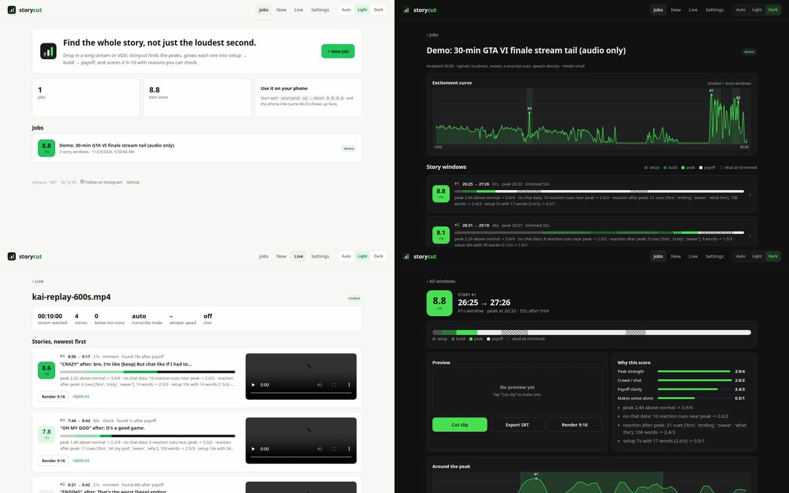
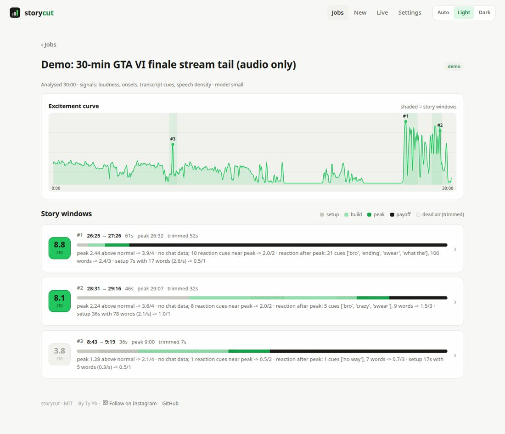
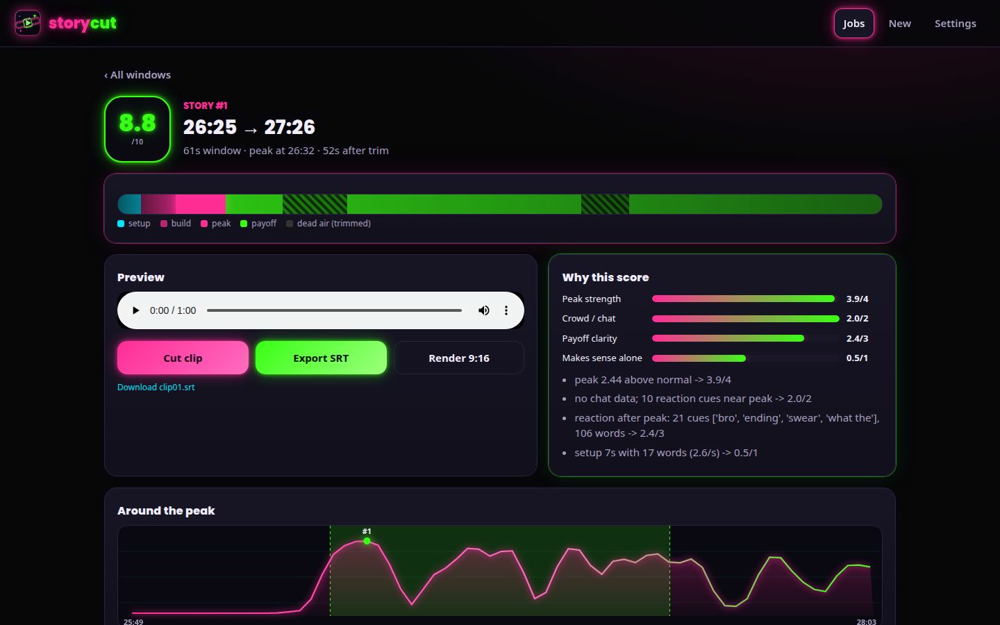
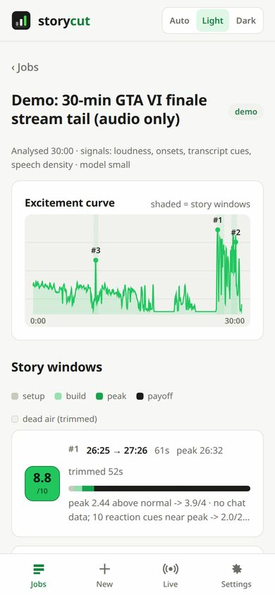

<p align="center">
  
</p>

<h1 align="center">storycut</h1>

<p align="center"><b>Find the whole story in long streams, not just the loudest second.</b><br>
Open-source clip finder: setup → build → payoff windows, scored 0–10 with reasons. Runs on CPU, no cloud key needed.</p>

<p align="center">
  <a href="LICENSE"></a>
  
  
  
</p>

<p align="center">
  
</p>

## Quick start

```bash
pip install git+https://github.com/jaamesboond/storycut   # needs ffmpeg on PATH
storycut find stream.mp4 -o out                           # ranked story windows + SRTs
storycut ui                                               # neon dashboard at http://127.0.0.1:8770
```

---

Most "auto-clip" tools return the peak moment: a scream, a chat spike, a kill.
A short built from that second alone makes no sense to someone who wasn't
watching. `storycut` finds the peak and then grows it into a **story window**:

```
setup  ->  build  ->  PEAK  ->  reaction / payoff
```

It walks back to where the situation starts and forward until the reaction
ends, snaps both ends to sentence boundaries, and gives each window a 0-10
score with plain-English reasons you can check.

It runs on CPU (tested on a 1.5-core Linux VM), needs no paid API, and is MIT
licensed.

---


## What it uses

| Signal | How |
|---|---|
| Transcript with word timestamps | [faster-whisper](https://github.com/SYSTRAN/faster-whisper), int8 on CPU |
| Loudness and excitement | RMS loudness per second + onset strength |
| Reaction keywords | "no way", "what just happened", laughter, crying, swearing, plus common Hindi/Urdu exclamations ("arey", "mar gaya", "ya allah", "bach gaya" ...) |
| Chat spikes (optional) | yt-dlp YouTube live chat replay, Twitch chat JSON, or any file of timestamps |
| Scene changes (optional) | ffmpeg `scdet` on a tiny low-fps proxy |
| LLM re-rank (optional, off by default) | Gemini, only if you set env vars; key is read from the environment and never stored |

Each signal is robust-z-normalised and clipped, so one loud explosion or one
spammy chat second cannot dominate. Missing signals (no chat, audio-only input)
are simply skipped.

## Install

```bash
git clone https://github.com/jaamesboond/storycut
cd storycut
pip install -r requirements.txt        # faster-whisper + numpy
# optional: pip install yt-dlp         # to pass VOD URLs directly
```

You also need `ffmpeg` / `ffprobe` on your PATH.

## Usage

```bash
# analyse a local file (video or audio)
python -m storycut find stream.mp4 -o out

# only a 25-minute chunk, starting at 2h10m
python -m storycut find stream.mp4 --start 2:10:00 --duration 25:00 -o out

# a VOD URL (downloads with yt-dlp, grabs chat replay when available)
python -m storycut find "https://www.youtube.com/watch?v=VIDEO_ID" -o out --scenes

# chat file you already have
python -m storycut find stream.mp4 --chat stream.live_chat.json -o out

# also cut each window to an mp4
python -m storycut find stream.mp4 -o out --cut
```

Useful options: `--model tiny|base|small|medium` (default `small`),
`--language en|hi|ur` (default auto-detect), `--target 60` (story length goal),
`--max-len 180` (hard cap), `--top 5`.

### Output (`out/`)

* `candidates.json` – ranked windows: start/end, peak, score, score parts, reasons,
  dead-air-trimmed pieces, transcript
* `report.md` – the same, readable
* `clipNN.srt` – word-timed captions relative to each window
* `clipNN.mp4` – cut clips (with `--cut`)
* `words.json` – the full transcript (used by `render`)

Example console output (real run, see "Tested on" below):

```
#1   8.8/10  00:26:25 -> 00:27:26  (61s)  peak 00:26:32
#2   8.1/10  00:28:30 -> 00:29:16  (46s)  peak 00:29:07
#3   3.8/10  00:08:43 -> 00:09:19  (36s)  peak 00:09:00
```

### Render a vertical Short (optional)

```bash
python -m storycut render stream.mp4 --from-report out/candidates.json --rank 1 \
  --facecam 340:245:36:460 --gameplay 1500:960:300:60 \
  --hook "HE DID NOT|SEE THIS|COMING" --end-text "WHO WAS RIGHT?" \
  --watermark logo.png -o short.mp4
```

* 1440x2560, facecam on top (1440x1040), gameplay below (1440x1520), no gap
* crops are `W:H:X:Y` in source pixels (measure them once per streamer layout)
* transparent captions: white bold text with a black outline, word-timed, on the seam
* hook text for the first 3 s, optional question in the last 2 s
* profanity is muted and covered with a 1 kHz beep, shown as `[BEEP]` in captions
* H.264 High, yuv420p, AAC, `+faststart` (uploads cleanly to YouTube/TikTok/Instagram)

Without `--facecam`, the gameplay is fitted to full width on a dark background.

## Dashboard (`storycut ui`)

```bash
storycut ui                         # http://127.0.0.1:8770  (a demo job is included)
storycut ui --host 0.0.0.0          # also reachable from your phone on the same Wi-Fi
storycut ui --jobs ~/clips --port 9000 --no-demo
```

A small local web app (Python standard library only, no build step, no extra
dependencies) on top of the same pipeline:

* **New job**: file path or VOD URL, start/duration chunk, Whisper model, story length, chat file, scene detection
* **Live progress** while it downloads, transcribes and scores (one heavy job at a time, so a small CPU is not overloaded)
* **Results**: excitement curve with every story window shaded, score badges, setup/build/peak/payoff timeline with trimmed dead air
* **Story detail**: score breakdown and reasons, transcript (profanity masked), clip preview, buttons to **cut clip**, **export SRT** and **render 9:16**
* **Settings**: default model and lengths, render crops, hook/end text, watermark
* Installable **PWA** (manifest + service worker): "Add to Home screen" on Android gives it its own icon and full-screen window

| Results | Story detail |
|---|---|
|  |  |

| New job | Phone (390 px) | Phone: detail |
|---|---|---|
|  |  |  |

The dashboard only listens on `127.0.0.1` unless you pass `--host 0.0.0.0`.
It has no login, so only expose it on a network you trust.

## On your phone (Android)

**Recommended: run storycut on a PC, open it on the phone.** Start
`storycut ui --host 0.0.0.0` on the computer; the home page shows the LAN link
(for example `http://192.168.1.20:8770`). Open it in Chrome on the phone (same
Wi-Fi) and choose **Add to Home screen**. Transcription runs on the PC, the phone
is just the remote.

**Fully on the phone with [Termux](https://termux.dev)** (possible, but slow):

```bash
pkg update && pkg install python ffmpeg git
pip install numpy
pip install faster-whisper            # may need: pkg install rust clang  (builds native parts)
pip install git+https://github.com/jaamesboond/storycut
storycut ui --host 0.0.0.0            # then open http://127.0.0.1:8770 in the phone browser
```

Honest notes: a phone CPU transcribes much slower than a PC, so use `--model tiny`
or `base` and short `--duration` chunks (10–20 min). Installing faster-whisper's
native dependencies on Termux can fail on some devices. The Termux steps above
are documented but **not yet tested on a real phone**; the dashboard itself was
tested in a 390x844 mobile viewport.

## How scoring works

| Part | Points | Meaning |
|---|---|---|
| Peak strength | 0-4 | how far the combined excitement stands above this stream's normal |
| Crowd | 0-2 | chat spike around the peak, or reaction-cue density if there is no chat |
| Payoff | 0-3 | reaction AFTER the peak: cues, laughter, people still talking about it |
| Self-explanatory | 0-1 | is there spoken setup a cold viewer can follow? |

Windows longer than 120 s lose 0.5. Every candidate lists its reasons, e.g.

```
- peak 2.31 above normal -> 3.7/4
- no chat data; 6 reaction cues near peak -> 2.0/2
- reaction after peak: 5 cues ['laugh', 'no way', 'swear'], 71 words -> 2.6/3
- setup 38s with 61 words (1.6/s) -> 1.0/1
```

The score is a **shortlist tool, not a judge**. Watch the top windows yourself
before posting.

### The story-cut rule

`storycut/story.py`:

1. Group words into sentences (end punctuation, pauses, max 15 s).
2. From the peak, walk **back** sentence by sentence while the setup budget
   (60% of `--target`) lasts. Stop early at a long pause or scene cut once at
   least 10 s of setup is included – that is usually where the situation began.
3. Walk **forward** to include at least 6 s of reaction, then keep going until
   the window reaches `--target` or the talk pauses.
4. Snap to sentence boundaries, never exceed `--max-len`.
5. Optionally list keep-pieces that squeeze silent stretches (> 2.5 s) out of
   the window, always keeping the peak itself.

## LLM re-rank (optional)

```bash
export STORYCUT_LLM=gemini
export GEMINI_API_KEY=...            # your own key, never commit it
export STORYCUT_GEMINI_MODEL=...     # optional model name
python -m storycut find stream.mp4 -o out --llm
```

Only the transcripts of the candidate windows are sent. Final score =
0.6 x signal score + 0.4 x LLM score. If the call fails, the run continues
with the signal scores.

## Why storycut vs other clippers

Honest comparison, from what has actually been tested:

| | storycut | typical auto-clippers |
|---|---|---|
| What it returns | a full **story window** (setup → payoff), cut at sentence ends | the peak seconds, fixed length |
| Explains itself | 0–10 score with per-part reasons | usually a single number or none |
| Cost / privacy | local, CPU, no account, no API key (LLM re-rank is opt-in) | many are cloud services with quotas |
| Languages | English + romanised Hindi/Urdu reaction cues | mostly English |
| Live recording | **no** (VODs and files only) | some record live streams directly |
| Face tracking / auto layout | **no**, crops are manual | some do |
| Quiet moments | **misses** silent shocked moments (no audio/chat signal) | same problem for audio-based tools |

On our one real test, the #1 window matched what a human editor had already cut
by hand. That is one stream, not a benchmark. If you run storycut next to
another tool on the same VOD, please share the results in an issue.

## Tested on

A 30-minute audio chunk from the end of a GTA VI finale livestream (English,
no chat file), `--model small`, on a 1.5-core VM: transcription + analysis took
about 4 minutes. A human editor had already cut this stream by hand, so we
could compare:

* **#1 (8.8/10, 26:25 to 27:26)** matched the hand-picked "worst ending" rant
  (hand cut: 26:26 to 27:14) almost exactly, including the lead-in.
* **#2 (8.1/10)** was the streamer's emotional recap a minute later, also a
  usable story.
* **Missed:** the quiet shocked moment when the characters die ("Yeah, he's
  gone", said softly). There is no loudness, cue or chat signal there, so
  audio-only scoring cannot see it. This is the main known limit.

The render helper was tested on a 15 s window: 1440x2560, H.264 High,
yuv420p, AAC; hook and end text visible, both swear words replaced by an
audible 1 kHz tone (measured about -29 dB in the 1 kHz band vs -61 dB
elsewhere), rendering took ~40 s on the same VM.

## Tests

```bash
python -m unittest discover -s tests -v
```

The pure logic (signals, peak picking, story expansion, scoring, chat parsing,
captions, beep filter, dashboard helpers) is covered without needing any media
files, and the dashboard server is tested in-process against the bundled demo job.

## Contributing

Bug reports, test results on real streams and new language cue lists are very
welcome. See [CONTRIBUTING.md](CONTRIBUTING.md) and [CHANGELOG.md](CHANGELOG.md).

## Limits

* Transcription is the slow part on CPU: roughly real-time / 2-4x with the
  `small` model on a small VM. Use `--duration` chunks or `--model base` for speed.
* Signals are audio + chat + text. A silent visual moment (no reaction, no chat)
  will be missed.
* Keyword cues are tuned for English and romanised Hindi/Urdu; other languages
  rely on loudness and chat only.
* Crops for `render` are manual; there is no automatic face tracking yet.
* Respect creators: only clip streams whose owners allow it, and credit them.

## License

MIT. The logo in `storycut/ui/static/logo.svg` is part of this project and under the same license.
