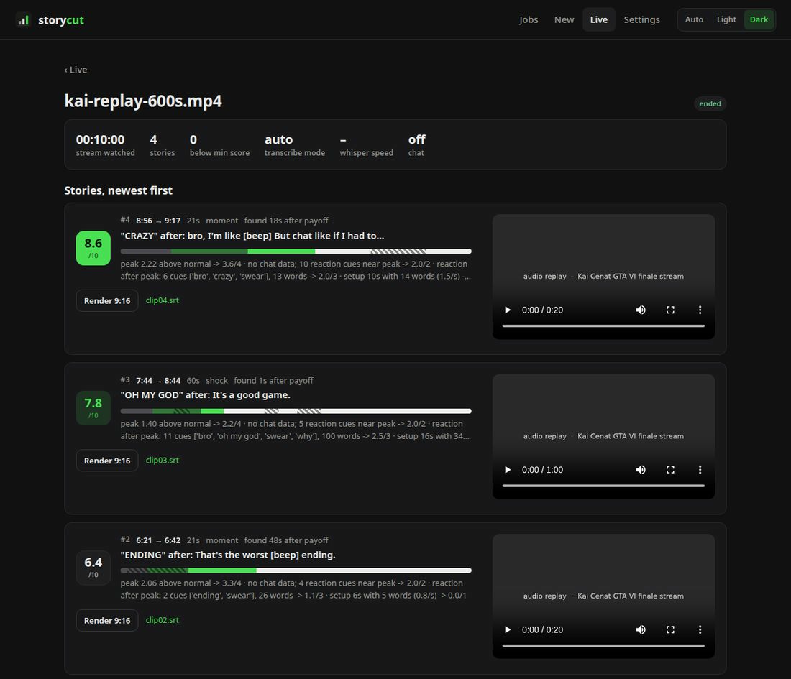
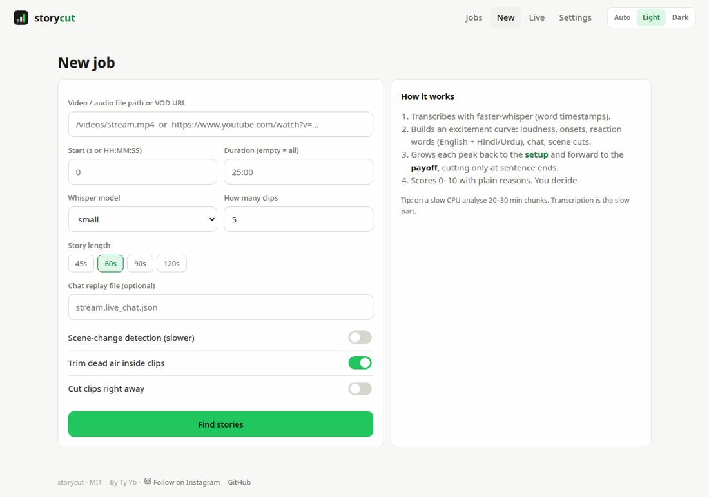
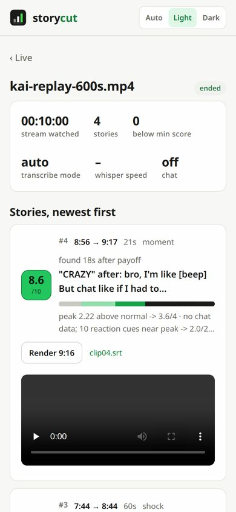
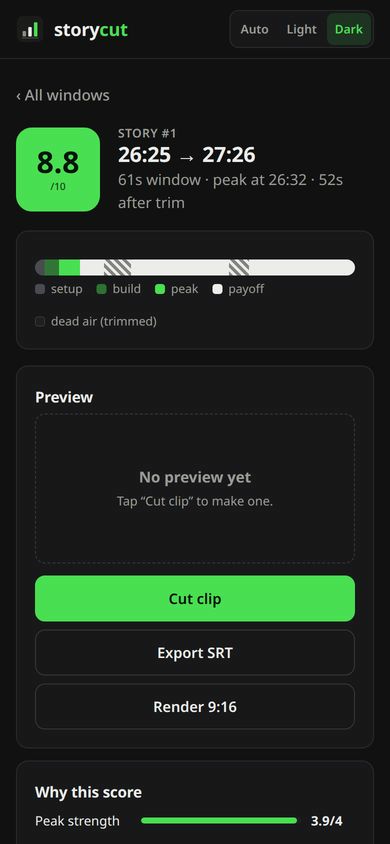

<p align="center">
  
</p>

<h1 align="center">storycut</h1>

<p align="center"><b>Find the whole story in long streams, not just the loudest second.</b><br>
Open-source clip finder: setup → build → payoff windows, scored 0–10 with reasons. Works on VODs and <b>live streams</b>. Runs on CPU, no cloud key needed.</p>

<p align="center">By <b>Ty Yb</b> · <a href="https://www.instagram.com/tayyabtufail">Follow on Instagram</a></p>

<p align="center">
  <a href="LICENSE"></a>
  
  
  
</p>

<p align="center">
  
</p>
<p align="center"><sub>Demo video (50 s, 1080p and 9:16): see the <a href="https://github.com/jaamesboond/storycut/releases">latest release</a> assets.</sub></p>

## Quick start

```bash
pip install git+https://github.com/jaamesboond/storycut   # needs ffmpeg on PATH
storycut find stream.mp4 -o out                           # ranked story windows + SRTs
storycut live https://www.twitch.tv/somechannel -o live  # stories while the stream is on
storycut ui                                               # dashboard at http://127.0.0.1:8770
```

---

Most "auto-clip" tools return the peak moment: a scream, a chat spike, a kill.
A short built from that second alone makes no sense to someone who wasn't
watching. `storycut` finds the peak and then grows it into a **story window**:

```
setup  ->  build  ->  PEAK  ->  reaction / payoff
```

It walks back to where the situation starts and forward until the reaction
ends, snaps both ends to sentence boundaries, and gives each window a 0-10
score with plain-English reasons you can check.

It runs on CPU (tested on a 1.5-core Linux VM), needs no paid API, and is MIT
licensed.

---


## What it uses

| Signal | How |
|---|---|
| Transcript with word timestamps | [faster-whisper](https://github.com/SYSTRAN/faster-whisper), int8 on CPU |
| Loudness and excitement | RMS loudness per second + onset strength |
| Reaction keywords | "no way", "what just happened", laughter, crying, swearing, plus common Hindi/Urdu exclamations ("arey", "mar gaya", "ya allah", "bach gaya" ...) |
| Chat spikes (optional) | yt-dlp YouTube live chat replay, Twitch chat JSON, or any file of timestamps |
| Scene changes (optional) | ffmpeg `scdet` on a tiny low-fps proxy |
| LLM re-rank (optional, off by default) | Gemini, only if you set env vars; key is read from the environment and never stored |

Each signal is robust-z-normalised and clipped, so one loud explosion or one
spammy chat second cannot dominate. Missing signals (no chat, audio-only input)
are simply skipped.

## Install

```bash
git clone https://github.com/jaamesboond/storycut
cd storycut
pip install -r requirements.txt        # faster-whisper + numpy
# optional: pip install yt-dlp         # to pass VOD URLs directly
# optional: pip install opencv-python-headless   # better face finding for --facecam auto
```

You also need `ffmpeg` / `ffprobe` on your PATH.

## Usage

```bash
# analyse a local file (video or audio)
python -m storycut find stream.mp4 -o out

# only a 25-minute chunk, starting at 2h10m
python -m storycut find stream.mp4 --start 2:10:00 --duration 25:00 -o out

# a VOD URL (downloads with yt-dlp, grabs chat replay when available)
python -m storycut find "https://www.youtube.com/watch?v=VIDEO_ID" -o out --scenes

# chat file you already have
python -m storycut find stream.mp4 --chat stream.live_chat.json -o out

# also cut each window to an mp4
python -m storycut find stream.mp4 -o out --cut
```

Useful options: `--model tiny|base|small|medium` (default `small`),
`--language en|hi|ur` (default auto-detect), `--target 60` (story length goal),
`--max-len 180` (hard cap), `--top 5`.

### Output (`out/`)

* `candidates.json` – ranked windows: start/end, peak, score, score parts, reasons,
  dead-air-trimmed pieces, transcript
* `report.md` – the same, readable
* `clipNN.srt` – word-timed captions relative to each window
* `clipNN.mp4` – cut clips (with `--cut`)
* `words.json` – the full transcript (used by `render`)

Example console output (real run, see "Tested on" below):

```
#1   8.8/10  00:26:25 -> 00:27:26  (61s)  peak 00:26:32
#2   8.1/10  00:28:30 -> 00:29:16  (46s)  peak 00:29:07
#3   3.8/10  00:08:43 -> 00:09:19  (36s)  peak 00:09:00
```

### Render a vertical Short (optional)

```bash
# let storycut find the camera, follow the face and cut the letterbox bars
python -m storycut render stream.mp4 --from-report out/candidates.json --rank 1 \
  --facecam auto --gameplay auto --captions karaoke \
  --hook "HE DID NOT|SEE THIS|COMING" --end-text "WHO WAS RIGHT?" \
  --watermark logo.png --loudnorm --thumb -o short.mp4

# or give the crops yourself (W:H:X:Y like ffmpeg, or x,y,w,h)
python -m storycut render stream.mp4 --from-report out/candidates.json --rank 1 \
  --facecam 340:245:36:460 --gameplay 1500:960:300:60 -o short.mp4

# just look at what auto finds (prints crops you can paste back in)
python -m storycut layout stream.mp4 --start 10:00 --duration 60
```

* 1440x2560, facecam on top (1440x1040), gameplay below (1440x1520), no gap
* `--facecam auto`: finds the streamer camera (a face that stays in one place, near
  an edge, on a still overlay, while the game moves around it), crops it to its
  real edges (dark strips trimmed), then **follows the face** inside it with
  smoothing and a dead zone so it stays centred when the streamer leans in or out
  (`--no-track` for a still crop, `--max-zoom` to limit zoom; it never zooms below
  480 source pixels because upscaling a tiny window only adds blur). If no camera is
  found it falls back to the full-width layout. `--gameplay auto` cuts letterbox
  bars with a bright-row scan.
* face finding uses OpenCV's face detector when `opencv-python-headless` is
  installed, otherwise a built-in skin-colour finder (numpy only, rougher)
* `--captions` styles, all word-timed from the whisper transcript:

  | Preset | Look |
  |---|---|
  | `clean` (default) | white bold text, black outline, no background |
  | `box` | black text on a white box |
  | `karaoke` | a 4-word line; the word being said lights up parrot green (#4ade52) |
  | `pop` | one or two big words at a time that pop in |
  | `minimal` | small lowercase text with a soft shadow |

* `--caption-pos seam|top|middle|lower-third` (default `seam` = on the camera/gameplay join)
* hook text for the first 3 s, optional question in the last 2 s
* profanity (English + Hindi/Urdu in Roman, Devanagari and Urdu script) is muted and
  covered with a 1 kHz beep, shown as `[beep]` in captions and in exported SRT files
* `--loudnorm` evens the loudness to -14 LUFS (the Shorts/TikTok level)
* `--thumb` saves `short.jpg`: the most expressive face frame (the face that looks most
  unlike its average in the clip, weighted by sharpness)
* `short.mp4.layout.json` records what was detected (crops, face track, notes)
* H.264 High, yuv420p, AAC, `+faststart` (uploads cleanly to YouTube/TikTok/Instagram)
* **one pass, upload-ready**: `-preset superfast -crf 23 -maxrate 7M -bufsize 14M` by default
  (`--preset`, `--crf`, `--maxrate`, `--threads` to change it)

### Render speed (benchmark)

A real 60 s split-screen Short (1080p60 stream source, facecam + gameplay crops,
word-timed captions, watermark) on the same 1.5-core VM, no GPU. Quality is SSIM
against a near-lossless (CRF 12) render of the same graph:

| Flow | Wall time | Size | SSIM |
|---|---|---|---|
| old: ultrafast CRF 18 master, then a medium CRF 23 re-encode | 370 s (74 + 296) | 54.6 MB | 0.9938 |
| new graph, veryfast CRF 23, 7M cap | 216 s | 43.6 MB | 0.9935 |
| new graph, faster CRF 23, 7M cap | 301 s | 47.7 MB | 0.9944 |
| **new graph, superfast CRF 22–23, 7M cap** (default) | **163–176 s** | 50.9–51.6 MB | 0.9949 (CRF 22) |
| new graph + `fast_bilinear` scaling | 230 s | 41.5 MB | 0.9819 (visibly softer) |

So the default is about **2.1–2.3x faster** than the old two-step flow with the
same or better measured quality. What made the difference: one encode instead of
two, seeking the input before decoding (only the needed seconds are read),
dropping 60 fps to 30 fps *before* cropping and scaling, and decoding the source
once for both crops. `fast_bilinear` did not save time here and lost detail.
Frames from each version were also compared by eye at full size; no visible
difference except the `fast_bilinear` one.

Without `--facecam`, the gameplay is fitted to full width on a dark background.

## Live mode (`storycut live`)

```bash
storycut live https://www.twitch.tv/<channel> -o live --cut       # Twitch (chat spikes read automatically)
storycut live "https://www.youtube.com/@<channel>/live" -o live    # YouTube
storycut live https://kick.com/<channel> -o live --wait 30         # Kick; keep checking 30 min if offline
storycut live /rec/stream.ts --follow -o live                      # a file another recorder is still writing
storycut live old_vod.mp4 --speed 4 -o test                        # replay a file "as if live" (testing)
```

What happens:

1. **Recording.** yt-dlp resolves the stream, ffmpeg writes 6-second MPEG-TS
   pieces. If the stream drops (network, ad break, restart) storycut reconnects
   and continues the same timeline. Pieces older than `--keep-min` (45 min) are
   deleted, except the ones a story still needs.
2. **Cheap signals first.** Every new piece is decoded once to 16 kHz mono:
   loudness and onsets per second, plus Twitch chat rate and "clip it" messages.
3. **Whisper only where it pays.** `--transcribe auto` measures how fast whisper
   runs on your machine. If it keeps up, everything is transcribed; if not,
   storycut only transcribes the minutes around a spike (the setup before it and
   the payoff after it). `--model tiny|base` for small CPUs.
4. **Wait for the payoff.** A spike opens a *pending story*. It is only posted
   when the payoff has closed: excitement back to normal for a few seconds, or a
   time cap. Then the window grows back to the setup, snaps to sentence ends, and
   is scored 0–10 with reasons, exactly like `find`.
5. **Optional output.** `--cut` writes `clipNN.mp4` + `clipNN.srt` the moment a
   story is posted; `--render` also makes the 9:16 split-screen Short.

Every story gets a readable title built from what was said (`"NO WAY" after:
we finally reached the tower`), a category guess (funny / shock / clutch /
fail ...), its setup / build / peak / payoff timestamps, and how many seconds
after the payoff it was found. Files in the output folder: `candidates.json`
(same format as `find`), `live.jsonl` (event log), `words.json`, `report.md`,
`state.json`.

**Restarts.** Run the same command with the same `-o` and it resumes: the
timeline, transcript, found stories and recorded pieces are reloaded. The
dashboard resumes running sessions on start.

**Dashboard.** The **Live** tab starts a session from a URL or file, shows
status (stream time, transcribe mode, whisper speed, chat), the pending spike,
stories as they appear with preview, and **Cut clip** / **Render 9:16** buttons.

### Tested (live)

A 10-minute recording replayed at 4x speed through `--speed 4` with
`--model base` on the 1.5-core VM:

* Found the stream's best moment, the "worst ending" rant, as story **#2,
  8.9/10, 06:31 → 07:30**, posted **5.5 s of stream time after the payoff
  closed**, and cut to `clip02.mp4` straight away. The offline `find` run on the
  same audio put the same moment at #1 (8.8/10, 06:25 → 07:26 on this timeline).
* Also posted a 5.7 and a 6.4 story; the offline run's #2 (a calm emotional
  recap) was **not** found live, because nothing in its audio spikes.
* Killed after 4 minutes and restarted with the same `-o`: it resumed at
  04:26 with the story it had already found, and finished the file.
* CPU: about 41 s of CPU time for the 10 minutes of stream (~7 % of one core
  in real time), recording + whisper base + analysis.
* Honest caveat: results depend on how busy the machine is. A later replay of
  the same file, run while screenshots were being taken, fell back to `gated`
  transcription earlier and posted the rant as a shorter 21 s story (6.4/10)
  plus 7.8 and 8.6 stories around it. On a loaded CPU, use `--transcribe all`
  with `--model tiny`, or give it more cores.

### storycut live vs PeakCut

[PeakCut](https://github.com/haziqahmedqasmi/PeakCut) is a good self-hosted
live clipper and we have used it ourselves. This is an honest list of where the
two differ, from reading its code (not a head-to-head benchmark).

| | storycut live | PeakCut live |
|---|---|---|
| Moment detection | loudness + onsets + reaction words (EN + Hindi/Urdu) + chat, robust-z over a 15-min baseline | loudness/chat spikes (+60 % jump) and trigger words; clip choice by an LLM judge |
| Needs an API key | no | yes for judging (Gemini); without it fewer clips get chosen |
| Clip shape | story window: setup → build → peak → payoff, cut at sentence ends, 20–180 s | fixed window around the spike, default 15–60 s |
| When a clip is posted | when the payoff has closed (seconds later) | after the next judge run (every few minutes) |
| Explanation | 0–10 score with per-part reasons, phases, latency | LLM title/reason when the judge runs |
| Titles | from the actual quote + setup line | LLM title, generic fallback without it |
| CPU on 1.5 cores | whisper only around spikes when the CPU cannot keep up | transcribes everything continuously |
| Restarts | resumes timeline, transcript and stories from the folder | resumes recordings and unfinished clips |
| Captions / render | 9:16 split-screen with word-timed captions on the seam | captions at the bottom |
| What PeakCut does that storycut does not | multi-channel management UI, auto-upload, LLM judgment of "is this interesting" from the transcript, picture-stall detection | |

Use what fits: PeakCut if you want an LLM to pick and you have a key with
quota; storycut if you want local, explainable full-story clips.

## Dashboard (`storycut ui`)

```bash
storycut ui                         # http://127.0.0.1:8770  (a demo job is included)
storycut ui --host 0.0.0.0          # also reachable from your phone on the same Wi-Fi
storycut ui --jobs ~/clips --port 9000 --no-demo
```

A small local web app (Python standard library only, no build step, no extra
dependencies) on top of the same pipeline:

* **New job**: file path or VOD URL, start/duration chunk, Whisper model, story length, chat file, scene detection
* **Live progress** while it downloads, transcribes and scores (one heavy job at a time, so a small CPU is not overloaded)
* **Results**: excitement curve with every story window shaded, score badges, setup/build/peak/payoff timeline with trimmed dead air
* **Story detail**: score breakdown and reasons, transcript (profanity masked), clip preview, buttons to **cut clip**, **export SRT** and **render 9:16**
* **Live**: start a live session, watch stories arrive, cut / render each one
* **Settings**: default model and lengths, render crops (or `auto`), caption style picker with previews, caption position, face tracking, loudness, thumbnail, hook/end text, watermark, light/dark theme
* Quiet, minimal look with proper **light and dark mode** (follows the system, or pick one)
* Installable **PWA** (manifest + service worker): "Add to Home screen" on Android gives it its own icon and full-screen window

| Results (light) | Story detail (dark) |
|---|---|
|  |  |

| Live session (dark) | New job |
|---|---|
|  |  |

| Phone: results | Phone: live | Phone: detail (dark) |
|---|---|---|
|  |  |  |

The dashboard only listens on `127.0.0.1` unless you pass `--host 0.0.0.0`.
It has no login, so only expose it on a network you trust.

## On your phone (Android)

**Recommended: run storycut on a PC, open it on the phone.** Start
`storycut ui --host 0.0.0.0` on the computer; the home page shows the LAN link
(for example `http://192.168.1.20:8770`). Open it in Chrome on the phone (same
Wi-Fi) and choose **Add to Home screen**. Transcription runs on the PC, the phone
is just the remote.

**Fully on the phone with [Termux](https://termux.dev)** (possible, but slow):

```bash
pkg update && pkg install python ffmpeg git
pip install numpy
pip install faster-whisper            # may need: pkg install rust clang  (builds native parts)
pip install git+https://github.com/jaamesboond/storycut
storycut ui --host 0.0.0.0            # then open http://127.0.0.1:8770 in the phone browser
```

Honest notes: a phone CPU transcribes much slower than a PC, so use `--model tiny`
or `base` and short `--duration` chunks (10–20 min). Installing faster-whisper's
native dependencies on Termux can fail on some devices. The Termux steps above
are documented but **not yet tested on a real phone**; the dashboard itself was
tested in a 390x844 mobile viewport.

## How scoring works

| Part | Points | Meaning |
|---|---|---|
| Peak strength | 0-4 | how far the combined excitement stands above this stream's normal |
| Crowd | 0-2 | chat spike around the peak, or reaction-cue density if there is no chat |
| Payoff | 0-3 | reaction AFTER the peak: cues, laughter, people still talking about it |
| Self-explanatory | 0-1 | is there spoken setup a cold viewer can follow? |

Windows longer than 120 s lose 0.5. Every candidate lists its reasons, e.g.

```
- peak 2.31 above normal -> 3.7/4
- no chat data; 6 reaction cues near peak -> 2.0/2
- reaction after peak: 5 cues ['laugh', 'no way', 'swear'], 71 words -> 2.6/3
- setup 38s with 61 words (1.6/s) -> 1.0/1
```

The score is a **shortlist tool, not a judge**. Watch the top windows yourself
before posting.

### The story-cut rule

`storycut/story.py`:

1. Group words into sentences (end punctuation, pauses, max 15 s).
2. From the peak, walk **back** sentence by sentence while the setup budget
   (60% of `--target`) lasts. Stop early at a long pause or scene cut once at
   least 10 s of setup is included – that is usually where the situation began.
3. Walk **forward** to include at least 6 s of reaction, then keep going until
   the window reaches `--target` or the talk pauses.
4. Snap to sentence boundaries, never exceed `--max-len`.
5. Optionally list keep-pieces that squeeze silent stretches (> 2.5 s) out of
   the window, always keeping the peak itself.

## LLM re-rank (optional)

```bash
export STORYCUT_LLM=gemini
export GEMINI_API_KEY=...            # your own key, never commit it
export STORYCUT_GEMINI_MODEL=...     # optional model name
python -m storycut find stream.mp4 -o out --llm
```

Only the transcripts of the candidate windows are sent. Final score =
0.6 x signal score + 0.4 x LLM score. If the call fails, the run continues
with the signal scores.

## Why storycut vs other clippers

Honest comparison, from what has actually been tested:

| | storycut | typical auto-clippers |
|---|---|---|
| What it returns | a full **story window** (setup → payoff), cut at sentence ends | the peak seconds, fixed length |
| Explains itself | 0–10 score with per-part reasons | usually a single number or none |
| Cost / privacy | local, CPU, no account, no API key (LLM re-rank is opt-in) | many are cloud services with quotas |
| Languages | English + romanised Hindi/Urdu reaction cues | mostly English |
| Live streams | **yes** (`storycut live`, Twitch/YouTube/Kick, growing files) | some record live streams directly |
| Face tracking / auto layout | **no**, crops are manual | some do |
| Quiet moments | **misses** silent shocked moments (no audio/chat signal) | same problem for audio-based tools |

On our one real test, the #1 window matched what a human editor had already cut
by hand. That is one stream, not a benchmark. If you run storycut next to
another tool on the same VOD, please share the results in an issue.

## Tested on

A 30-minute audio chunk from the end of a GTA VI finale livestream (English,
no chat file), `--model small`, on a 1.5-core VM: transcription + analysis took
about 4 minutes. A human editor had already cut this stream by hand, so we
could compare:

* **#1 (8.8/10, 26:25 to 27:26)** matched the hand-picked "worst ending" rant
  (hand cut: 26:26 to 27:14) almost exactly, including the lead-in.
* **#2 (8.1/10)** was the streamer's emotional recap a minute later, also a
  usable story.
* **Missed:** the quiet shocked moment when the characters die ("Yeah, he's
  gone", said softly). There is no loudness, cue or chat signal there, so
  audio-only scoring cannot see it. This is the main known limit.

The render helper was tested on a 15 s window: 1440x2560, H.264 High,
yuv420p, AAC; hook and end text visible, both swear words replaced by an
audible 1 kHz tone (measured about -29 dB in the 1 kHz band vs -61 dB
elsewhere), rendering took ~40 s on the same VM in 0.2. In 0.3 a 16 s window
(1080p60 source, facecam + gameplay, captions, watermark) renders in ~28 s.

## Tests

```bash
python -m unittest discover -s tests -v
```

The pure logic (signals, peak picking, story expansion, scoring, chat parsing,
captions, beep filter, caption presets, facecam/letterbox detection on synthetic
frames, face-track smoothing, swear lists, dashboard helpers) is covered without needing
any media files (one tiny render smoke test runs if ffmpeg is installed), and the dashboard server is tested in-process against the bundled demo job.

## Contributing

Bug reports, test results on real streams and new language cue lists are very
welcome. See [CONTRIBUTING.md](CONTRIBUTING.md) and [CHANGELOG.md](CHANGELOG.md).

## Limits

* Transcription is the slow part on CPU: roughly real-time / 2-4x with the
  `small` model on a small VM. Use `--duration` chunks or `--model base` for speed.
* Signals are audio + chat + text. A silent visual moment (no reaction, no chat)
  will be missed.
* Keyword cues are tuned for English and romanised Hindi/Urdu; other languages
  rely on loudness and chat only.
* `--facecam auto` needs a webcam overlay with a visible face; it was tested on one
  real stream layout so far (a cut-out cam in a corner). Without OpenCV the
  skin-colour finder can be fooled by skin-toned game scenes; check
  `storycut layout` once per streamer and pass the crop by hand if it is off.
  Tracking only moves when the camera box is bigger than the 9:16 top window.
* Live mode: in `gated` transcription a moment that is only *said* (no loudness
  or chat bump) can be missed; reconnects can leave a gap of a few seconds in
  the recording; Twitch chat needs outbound IRC (port 6667); YouTube/Kick chat
  is not read live yet.
* Respect creators: only clip streams whose owners allow it, and credit them.

## Author

Made by **Ty Yb**. Follow on Instagram: [@tayyabtufail](https://www.instagram.com/tayyabtufail).
Maintained on GitHub by [jaamesboond](https://github.com/jaamesboond).

## License

MIT. The logo in `storycut/ui/static/logo.svg` is part of this project and under the same license.
